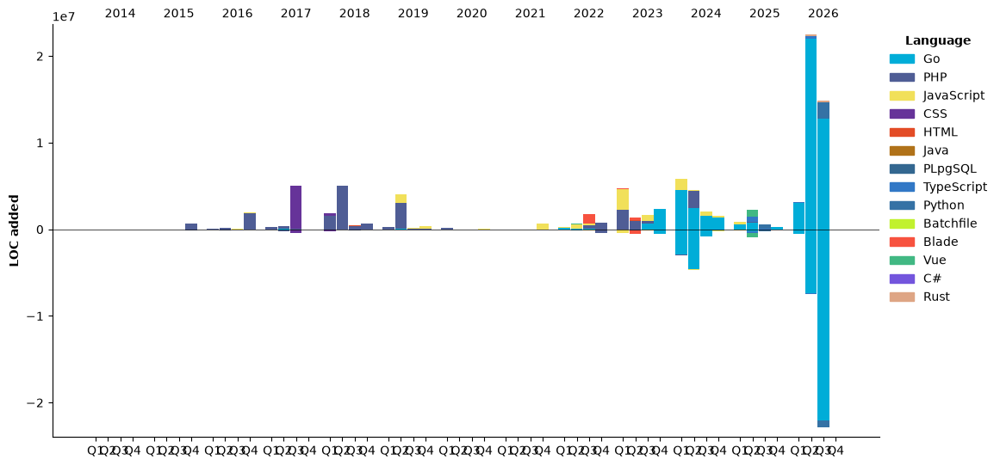

# **Hi there, I'm Deloz (*´ー｀*), and this is my profile readme.**

## **What languages you use and how much do you code?**

<!--START_SECTION:waka-->


**🐱 My GitHub Data** 

> 📦 4.3 MB Used in GitHub's Storage 
 > 
> 🏆 4,742 Contributions in the Year 2026
 > 
> 💼 Opted to Hire
 > 
> 📜 47 Public Repositories 
 > 
> 🔑 220 Private Repositories 
 > 
**I'm an Early 🐤** 

```text
🌞 Morning                19891 commits       █████░░░░░░░░░░░░░░░░░░░░   20.04 % 
🌆 Daytime                44352 commits       ███████████░░░░░░░░░░░░░░   44.69 % 
🌃 Evening                28201 commits       ███████░░░░░░░░░░░░░░░░░░   28.42 % 
🌙 Night                  6797 commits        ██░░░░░░░░░░░░░░░░░░░░░░░   06.85 % 
```
📅 **I'm Most Productive on Monday** 

```text
Monday                   16880 commits       ████░░░░░░░░░░░░░░░░░░░░░   17.01 % 
Tuesday                  14654 commits       ████░░░░░░░░░░░░░░░░░░░░░   14.77 % 
Wednesday                15313 commits       ████░░░░░░░░░░░░░░░░░░░░░   15.43 % 
Thursday                 14180 commits       ████░░░░░░░░░░░░░░░░░░░░░   14.29 % 
Friday                   14291 commits       ████░░░░░░░░░░░░░░░░░░░░░   14.40 % 
Saturday                 11426 commits       ███░░░░░░░░░░░░░░░░░░░░░░   11.51 % 
Sunday                   12497 commits       ███░░░░░░░░░░░░░░░░░░░░░░   12.59 % 
```


📊 **This Week I Spent My Time On** 

```text
🕑︎ Time Zone: Asia/Shanghai

💬 Programming Languages: 
Rust                     27 hrs 46 mins      ███████░░░░░░░░░░░░░░░░░░   29.36 % 
Other                    27 hrs 4 mins       ███████░░░░░░░░░░░░░░░░░░   28.62 % 
TypeScript               6 hrs 5 mins        ██░░░░░░░░░░░░░░░░░░░░░░░   06.44 % 
Python                   5 hrs 15 mins       █░░░░░░░░░░░░░░░░░░░░░░░░   05.56 % 
SQL                      4 hrs 46 mins       █░░░░░░░░░░░░░░░░░░░░░░░░   05.04 % 

🔥 Editors: 
Codex CLI                82 hrs 57 mins      ██████████████████████░░░   87.70 % 
VS Code                  11 hrs 29 mins      ███░░░░░░░░░░░░░░░░░░░░░░   12.16 % 
Codex Vscode             8 mins              ░░░░░░░░░░░░░░░░░░░░░░░░░   00.15 % 

💻 Operating System: 
Linux                    60 hrs 55 mins      ████████████████░░░░░░░░░   64.40 % 
Windows                  33 hrs 40 mins      █████████░░░░░░░░░░░░░░░░   35.60 % 
```

🤖 **AI Coding This Week** 

```text
⏱ AI Coding Time: 94 hrs 31 mins (99.93%)

✍️ 70,306 lines written by AI, 5 lines written by hand (99.99% AI-written)

🔤 346,634,947 Input Tokens, 15,902,710 Output Tokens

💵 $11784.59 Estimated AI Cost This Week

🧠 205 AI Sessions, 737 AI Prompts

Codex-Vscode             50,958 lines        █████████████████░░░░░░░░   68.76 % 
Vscode                   23,153 lines        ████████░░░░░░░░░░░░░░░░░   31.24 % 
DeepSeek                 0 lines             ░░░░░░░░░░░░░░░░░░░░░░░░░   00.00 % 
GPT                      0 lines             ░░░░░░░░░░░░░░░░░░░░░░░░░   00.00 % 
Codex-Exec               0 lines             ░░░░░░░░░░░░░░░░░░░░░░░░░   00.00 % 

🔎 AI Coding Insights:
🤖 AI-Driven — 99.99% of written lines came from AI
📄 Detailed Prompter — average 1,431 characters per prompt
🔁 Iterative Prompter — average 4 prompts per session
🚀 High AI Trust — 0.01% of changed lines were hand-edited
```

**I Mostly Code in PHP** 

```text
JavaScript               38 repos            ████░░░░░░░░░░░░░░░░░░░░░   15.02 % 
Python                   24 repos            ██░░░░░░░░░░░░░░░░░░░░░░░   09.49 % 
TypeScript               12 repos            █░░░░░░░░░░░░░░░░░░░░░░░░   04.74 % 
Vue                      9 repos             █░░░░░░░░░░░░░░░░░░░░░░░░   03.56 % 
Rust                     5 repos             ░░░░░░░░░░░░░░░░░░░░░░░░░   01.98 % 
```


**Timeline**




 Last Updated on 01/11/2026 19:11:57 UTC
<!--END_SECTION:waka-->
